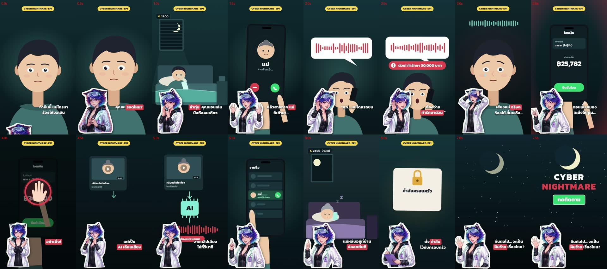

# Cyber Nightmare

A Claude Code skill for vertical (1080×1920) motion-graphic Reels: second-person cyber/scam survival stories ("ถ้าคืนนี้… คุณจะรอดไหม?"). Flat-vector scenes are drawn in code (SVG + GSAP, rendered with HyperFrames). Moon narrates from the bottom-left corner. One voice-over becomes a long clip, a ≤30 s short clip, 2 covers and captions.

- Install: open this folder in Claude Code and type "อ่าน SETUP.md แล้วติดตั้งให้หน่อย".
- Use: send a voice-over and ask for a Cyber Nightmare episode. See `SKILL.md`.

Voice files are not included.
